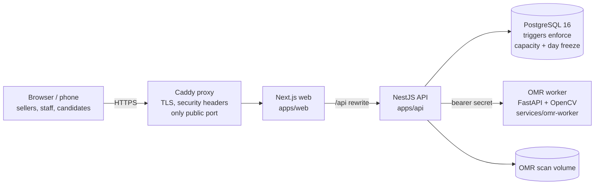

# Hilal Bilet Sistemi

Centralized examination ticket sales for a network of branches, printed
answer sheets with OMR (optical mark recognition) scanning, a manual review
queue, and a public, rate-limited result lookup. The user interface is in
Azerbaijani.

| Document | Purpose |
| --- | --- |
| [docs/DEPLOYMENT.md](docs/DEPLOYMENT.md) | Installing on a server: DNS, TLS, secrets, first admin |
| [docs/OPERATIONS.md](docs/OPERATIONS.md) | Daily operation, backups, restore, monitoring, incidents |
| [docs/OMR.md](docs/OMR.md) | Answer sheet template, recognition, review rules, scoring |
| [docs/API.md](docs/API.md) | HTTP API overview (Swagger UI outside production) |
| [docs/IMPLEMENTATION_STATUS.md](docs/IMPLEMENTATION_STATUS.md) | What is implemented and verified |
| [docs/guides/](docs/guides/) | User guides in Azerbaijani (seller, branch manager, admin, results operator) |

## Quick start (full stack in Docker)

Requirements: Docker Engine 24+ with Compose v2, `openssl`.

```bash
git clone <repository-url> hilal && cd hilal
cp .env.example .env
./scripts/generate-secrets.sh .env      # replaces every change-me value
docker compose --profile production up -d --build --wait
```

Open <http://localhost> (or `PUBLIC_URL`) and sign in with
`BOOTSTRAP_ADMIN_EMAIL` / `BOOTSTRAP_ADMIN_PASSWORD` from `.env`. Remove
`BOOTSTRAP_ADMIN_PASSWORD` from `.env` after the first login.

Skipping `generate-secrets.sh` is deliberately fatal: the API refuses to
start in production while any secret is a placeholder.

## Local development

Requirements: Node.js 22 (20–24 supported by Prisma), pnpm 9.15, Python 3.12,
Docker.

```bash
pnpm install
docker compose -f docker-compose.yml -f docker-compose.dev.yml up -d postgres worker
cd apps/api && cp ../../.env.example .env   # then set DATABASE_URL etc. for localhost
pnpm prisma:deploy && pnpm start:dev        # API on :3001, Swagger on /api/docs
cd ../web && pnpm dev                       # web on :3000, proxies /api to :3001
```

## Architecture



Redis runs in the stack but is not used by the code yet (reserved for queues).

| Path | Content |
| --- | --- |
| `apps/api` | NestJS API, Prisma schema and migrations, unit + e2e tests |
| `apps/web` | Next.js App Router UI (staff dashboard and public pages) |
| `services/omr-worker` | Answer sheet PDF generation and recognition (Python) |
| `e2e` | Playwright smoke/accessibility suite and the concurrent-sales load test |
| `scripts` | Secret generation, backup, restore, restore drill |
| `deploy` | Caddy configuration |

## Environment reference

Docker Compose reads `.env`; every variable without a default must be set.

| Variable | Required | Default | Meaning |
| --- | --- | --- | --- |
| `PUBLIC_URL` | yes | — | Browser origin, used as the API CORS allow-list |
| `SITE_ADDRESS` | yes | — | Caddy site: a domain enables automatic HTTPS; `:80` = plain HTTP (local only) |
| `HTTP_PORT` / `HTTPS_PORT` | no | 80 / 443 | Published proxy ports |
| `POSTGRES_USER` / `POSTGRES_DB` | no | `hilal` | Database user and name |
| `POSTGRES_PASSWORD` | yes | — | Database password |
| `JWT_SECRET` | yes | — | Session token signing key (≥ 32 chars) |
| `QR_SIGNING_SECRET` | yes | — | HMAC key for ticket QR codes (≥ 32 chars, ≠ `JWT_SECRET`) |
| `OMR_WORKER_SECRET` | yes | — | Shared secret API → OMR worker (≥ 32 chars) |
| `BOOTSTRAP_ADMIN_EMAIL` / `_PASSWORD` | first start | — | Creates the first SUPER_ADMIN if none exists (password ≥ 12 chars) |
| `BOOTSTRAP_BRANCH_CODE` / `_NAME` | no | `MERKEZ` / `Mərkəzi ofis` | Branch for the first admin |
| `API_RATE_LIMIT_PER_MINUTE` | no | 300 (compose), 60 (code) | Per client IP, all API routes |
| `AUTH_LOGIN_RATE_LIMIT_PER_MINUTE` | no | 10 | Per client IP, login attempts |
| `NEXT_PUBLIC_OMR_ENABLED` | no | `true` | Build-time switch for the OMR screens |

The API process additionally understands `DATABASE_URL`, `CORS_ORIGIN`,
`OMR_WORKER_URL`, `OMR_STORAGE_DIR`, `OMR_MAX_STORAGE_BYTES`,
`API_TRUSTED_PROXIES`, which Compose sets for you. Validation lives in
`apps/api/src/config/env.validation.ts`.

## Roles

| Capability | SUPER_ADMIN / CENTRAL_ADMIN | BRANCH_MANAGER | SELLER | OMR_OPERATOR | Public |
| --- | --- | --- | --- | --- | --- |
| Branches, users, exams, question bank | all | view exams | — | — | — |
| Sell tickets, register buyer, take cash | any branch | own branch | own branch | — | online order |
| See tickets and sales reports | all branches | own branch | own branch | — | own receipt |
| Cancel a ticket | any | — | tickets they sold | — | — |
| Admit at the door (QR scan) | any | own branch | own branch | — | — |
| Close the business day | any branch | own branch | view only | — | — |
| Answer keys | create | view | — | view | — |
| Issue/scan answer sheets, review queue | any | own branch | — | own branch | — |
| Publish / hide results | yes | — | — | view readiness | — |
| Result lookup | — | — | — | — | ticket + candidate number, published only |

Every rule is enforced by the API; the UI only hides what a role cannot use.

## Checks

```bash
pnpm typecheck && pnpm lint && pnpm build
pnpm --filter @hilal/api test                        # unit (needs DATABASE_URL for 2 suites)
TEST_DATABASE_URL=… DATABASE_URL=… pnpm --filter @hilal/api test:e2e   # *_test database only
pnpm --filter @hilal/web test
(cd services/omr-worker && pip install -r requirements-dev.txt && pytest)   # Linux; see docs/OMR.md
API_URL=… ADMIN_EMAIL=… ADMIN_PASSWORD=… pnpm --filter @hilal/e2e load
BASE_URL=… ADMIN_EMAIL=… ADMIN_PASSWORD=… pnpm --filter @hilal/e2e smoke
```

CI runs all of the above (`.github/workflows/ci.yml`).
